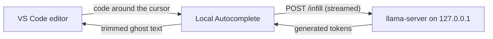

# Local Autocomplete

[](LICENSE)


**Tab autocomplete for VS Code, powered by a code model running on your own machine.**

The extension shows inline (ghost-text) completions from a local
[llama.cpp](https://github.com/ggml-org/llama.cpp) `llama-server` through its fill-in-the-middle
`/infill` endpoint. Your code never leaves your machine: no cloud, no account, no telemetry and no
runtime dependencies.

## Features

- **Inline completions** for the current line or block. `Tab` accepts, `Esc` dismisses.
- **Block-aware output**: small models tend to keep going into the next function. The completion is
  trimmed to the block under the cursor, and unfinished nested blocks and half-written lines are dropped.
- **Bracket merging**: brackets VS Code has already auto-closed after the cursor are not duplicated.
- **Fast on modest hardware**: the response is streamed and generation stops as soon as the block is
  complete. The prompt is split so that llama-server reuses its cache and only reprocesses the line
  you are typing.
- **Status bar item** that shows on/off, server state and a spinner while a request runs. Click it to
  toggle completions.
- **Private by design**: requests go only to the configured endpoint (`http://127.0.0.1:8012` by default).

## Requirements

- VS Code 1.144 or newer.
- A recent [llama.cpp](https://github.com/ggml-org/llama.cpp) build that includes `llama-server`.
  See its [installation guide](https://github.com/ggml-org/llama.cpp/blob/master/docs/install.md)
  (for example `brew install llama.cpp` or `winget install llama.cpp`, or a prebuilt release).
- A FIM-trained code model. The command below downloads one automatically.

## Getting started

### 1. Start the model server

```sh
llama-server --fim-qwen-1.5b-default -c 8192 --sleep-idle-seconds 600
```

The first run downloads Qwen2.5-Coder 1.5B (Q8_0, about 1.6 GB) to the Hugging Face cache. It is
small enough for machines with 8 GB of RAM.

| Flag | Purpose |
| --- | --- |
| `--fim-qwen-1.5b-default` | Built-in preset: model, port `8012` and batch sizes tuned for FIM. |
| `-c 8192` | Context size in tokens. The extension sends at most about 320 lines around the cursor; without this flag the server allocates the model's full 32k context, which needs about 0.9 GB more memory. |
| `--sleep-idle-seconds 600` | After 10 idle minutes the server unloads the model and frees almost all memory. The next completion wakes it up, which takes a couple of seconds. |

If you want better completions and have the RAM to spare, use `--fim-qwen-3b-default` instead.
Completions will be slower.

### 2. Install the extension

The extension is not published on the Marketplace. To build it from source you need
[Node.js](https://nodejs.org/) 22 or newer:

```sh
git clone https://github.com/olgln/vscode-local-autocomplete.git
cd vscode-local-autocomplete
npm install
npm run package          # creates local-autocomplete-0.1.0.vsix, no extra tools needed
```

Then, in VS Code, open the Extensions view, click `···`, choose **Install from VSIX…** and pick
the file you just built. To update later, pull the changes, run `npm run package` again and
install the new file the same way.

To try it without installing, open the folder in VS Code and press `F5`. See
[Development](#development).

## Usage

- Type and pause briefly. The suggestion appears as ghost text.
- `Tab` accepts the whole suggestion. `Ctrl+→` (`Cmd+→` on macOS) accepts it one word at a time.
- `Alt+\` requests a suggestion manually.
- Command Palette:
  - **Local Autocomplete: Toggle On/Off**
  - **Local Autocomplete: Check Server**

Completions are skipped while the IntelliSense list is open, when there is already code to the
right of the cursor, and right after a paste or dictation (until you type again).

## Settings

| Setting | Default | Description |
| --- | --- | --- |
| `localAutocomplete.enabled` | `true` | Show inline completions from the local model. |
| `localAutocomplete.endpoint` | `http://127.0.0.1:8012` | Base URL of llama-server. Requests go only here. |
| `localAutocomplete.disabledLanguages` | `["markdown", "plaintext"]` | Language IDs where completions are turned off. |
| `localAutocomplete.debounceMs` | `200` | Pause in typing (ms) before a request is sent. |
| `localAutocomplete.prefixLines` | `256` | Lines before the cursor sent as context. |
| `localAutocomplete.suffixLines` | `64` | Lines after the cursor sent as context. |
| `localAutocomplete.maxTokens` | `128` | Maximum number of tokens to generate. |
| `localAutocomplete.maxPredictMs` | `2000` | Generation time limit (ms); the server stops at the next new line once it is exceeded. |
| `localAutocomplete.maxLineSuffix` | `8` | Skip automatic completion when more than this many non-space characters follow the cursor. |
| `localAutocomplete.timeoutMs` | `5000` | Abort a request that takes longer than this (ms). |

## Troubleshooting

- **Warning icon in the status bar**: the server is not reachable. Start `llama-server`, check
  `localAutocomplete.endpoint`, then run **Local Autocomplete: Check Server**.
- **Per-request timings**: open the Output panel, select **Local Autocomplete**, and set the log level
  to Debug with the gear icon.

## Limitations

- Small local models work well for short completions (a line or a small block). They are weaker than
  large cloud models at long, multi-function suggestions.
- Only the current file is used as context.

## How it works



1. After a short pause in typing, the extension takes up to 256 lines before and 64 lines after the
   cursor and sends them to `/infill`. The current line goes into a separate field, so the server
   reuses its cache for everything above it.
2. The answer is streamed. As soon as the block under the cursor is complete, the extension closes
   the stream and the server stops generating.
3. The text is cleaned up before it is shown: code that repeats what is already below the cursor,
   unfinished nested blocks and brackets that VS Code has already auto-closed are removed.

## Development

```sh
npm install   # dev dependencies only: typescript, @types/vscode (pinned; install scripts disabled in .npmrc)
npm test      # compile + unit tests
npm run package   # compile + build the .vsix
```

Open the folder in VS Code and press `F5`. An Extension Development Host window opens with the
extension loaded, and the TypeScript watcher rebuilds on save. The tests use Node's built-in test
runner and a fake HTTP server, so no model is needed.

### Project structure

```
src/
├── extension.ts          activate(): wires provider, status bar, commands, settings listener
├── config.ts             localAutocomplete.* settings (defaults live in package.json)
├── commands.ts           Toggle On/Off, Check Server; server health → status bar
├── completion/
│   ├── provider.ts       InlineCompletionItemProvider: debounce, cancellation, logging
│   ├── context.ts        cursor + document → FIM request (pure, unit-tested)
│   └── postprocess.ts    cleans model output (pure, unit-tested)
├── llama/
│   └── client.ts         POST /infill (streamed), GET /health via built-in fetch
└── ui/
    └── status-bar.ts     on/off, server state, spinner; click toggles
test/                     mirrors src/; node --test against the compiled out/
scripts/package.mjs       builds the .vsix (a zip) without vsce
```

## Contributing

Issues and pull requests are welcome. Please run `npm test` before you open a pull request, and
check completion quality by hand on JavaScript, TypeScript and Python. New runtime dependencies will
not be accepted: the extension talks only to the local server.

## Acknowledgements

- [llama.cpp](https://github.com/ggml-org/llama.cpp) for `llama-server` and the FIM presets.
- [llama.vscode](https://github.com/ggml-org/llama.vscode) was a reference for the `/infill`
  request layout.

## License

[MIT](LICENSE)
